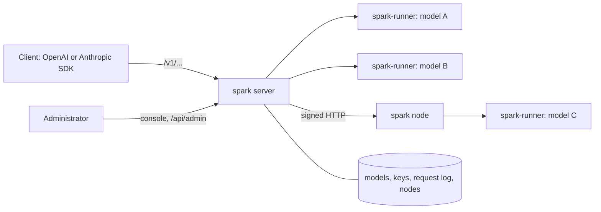

<p align="center">
  <picture>
    <source media="(prefers-color-scheme: dark)" srcset="assets/spark-lockup-on-ink.svg">
    
  </picture>
</p>

# Spark

Run GGUF language models on your own hardware, behind the OpenAI and Anthropic APIs you already use.

Spark is an inference server written in C# (.NET 10). Point an OpenAI or Anthropic SDK at it, or
[Curiosity Studio](https://curiosity.ai), and the models run on your machines: nothing leaves them.

- **Two APIs on one port.** `POST /v1/chat/completions`, `POST /v1/completions`, `POST /v1/embeddings` and
  `GET /v1/models` (OpenAI), `POST /v1/messages` and `POST /v1/messages/count_tokens` (Anthropic). Streaming
  (server-sent events), tool calls, reasoning (`reasoning_content` and `thinking` blocks), JSON mode and JSON schema,
  stop sequences.
- **A management console** (`/`, password protected): the model library, Hugging Face search and download, runners,
  API keys, a playground, the request log with a timeline of every step, activity, settings and nodes.
- **Models never run in the server.** Each loaded model lives in a `spark-runner` child process. A runner that
  crashes, is killed or hangs is restarted and its model reloaded, and the server keeps answering.
- **Placement by memory.** Spark probes the CUDA devices, puts a model where its weights, KV cache and work buffers
  fit, unloads idle models to make room, and refuses a model that fits nowhere with the arithmetic instead of
  starting it to fail.
- **Images and embeddings.** A model with a multimodal projector reads images (OpenAI `image_url` parts and Anthropic
  `image` blocks). Embedding models answer `/v1/embeddings`.
- **KV cache that survives other conversations.** The next turn of a chat reuses the live cache. A conversation pushed
  out by another is saved as a snapshot and restored when it comes back.
- **Fleet.** A central server routes to models on nodes (other machines, other GPUs) that joined it with a one-time
  token. Every call between them is signed.
- **Zero retention, per API key.** A key can be created so that its requests are logged without their content.

Spark places models on NVIDIA GPUs with CUDA 12 when it finds them, and otherwise runs them on the CPU (x64 with AVX2
or AVX-512, and ARM64). See [Limitations](#limitations) for what it does not do.

## Install

**Linux and macOS:**

```bash
curl -fsSL https://raw.githubusercontent.com/curiosity-ai/spark/refs/heads/main/install.sh | sh
```

**Windows** (PowerShell 5.1 or 7):

```powershell
irm https://raw.githubusercontent.com/curiosity-ai/spark/refs/heads/main/install.ps1 | iex
```

The script downloads the latest release for your platform and checks its SHA-256. It installs the program in
`~/.curiosity/spark` and puts it on your `PATH`:

- **Linux and macOS:** a launcher goes in `~/.curiosity/bin` (shared with curio and the Curiosity Orchestrator), and
  your shell profile gets that folder on `PATH`.
- **Windows:** the program folder is added to your user `PATH`.

**Settings**, all optional, as environment variables:

| Variable | Meaning |
|---|---|
| `SPARK_VERSION` | Install a specific release, such as `v26.10.6452`, instead of the latest |
| `SPARK_INSTALL` | Install under another folder instead of `~/.curiosity` |
| `SPARK_NO_MODIFY_PATH=1` | Leave `PATH` and your shell profile alone |
| `GITHUB_TOKEN` | A GitHub token, if you hit the API's anonymous rate limit (`GH_TOKEN` works too) |

```bash
curl -fsSL https://raw.githubusercontent.com/curiosity-ai/spark/main/install.sh | SPARK_VERSION=v26.10.6452 sh
```

**To upgrade**, run the script again. It replaces the program folder; your data and models are stored elsewhere
(see `SPARK_STORAGE`), so they are kept. Restart Spark afterwards. On Windows, stop it first: Windows locks the folder
of a running program.

On a machine with an NVIDIA GPU the script warns you if cuBLAS 12 (`libcublas.so.12`) is missing. Install the CUDA 12
toolkit or the `libcublas-12-*` package, or use the [Docker image](#docker). Without a GPU, models run on the CPU.

### Manual download

Every [release](https://github.com/curiosity-ai/spark/releases) has an archive per platform: `linux-x64`,
`linux-arm64`, `osx-x64`, `osx-arm64` and `win-x64`. Check yours against the release's `SHA256SUMS`, then extract it
and run it:

```bash
tar -xzf spark-<version>-linux-x64.tar.gz
cd spark-<version>-linux-x64
SPARK_ADMIN_PASSWORD='choose-a-password' ./spark
```

Keep the folder together: it holds the server, `spark-runner`, the CUDA kernels, the native libraries and the web
console (`wwwroot/`). CUDA on Linux needs the NVIDIA driver and cuBLAS 12. On Windows it needs the CUDA toolkit's
`cublas64_12.dll` on the `PATH`.

## Quick start

```bash
SPARK_ADMIN_PASSWORD='choose-a-password' SPARK_STORAGE="$HOME/.curiosity/spark-data" spark
```

1. Open <http://localhost:8080> and sign in as `admin` with that password.
2. Under **Discover**, search Hugging Face for a GGUF model and download it. A small one such as
   `SmolLM2-135M-Instruct` is enough to try it out. Any `.gguf` file copied into `$SPARK_STORAGE/models` also appears
   in the library.
3. Under **API keys**, create a key.
4. Call it:

```bash
curl http://localhost:8080/v1/chat/completions \
  -H "Authorization: Bearer sk-spark-…" -H "Content-Type: application/json" \
  -d '{"model": "smollm2-135m-instruct-q8_0", "messages": [{"role": "user", "content": "Hello!"}], "stream": true}'
```

Any OpenAI SDK works with `base_url = http://localhost:8080/v1`. Any Anthropic SDK works with
`base_url = http://localhost:8080`:

```python
from openai import OpenAI

client = OpenAI(base_url="http://localhost:8080/v1", api_key="sk-spark-…")
reply = client.chat.completions.create(
    model="smollm2-135m-instruct-q8_0",
    messages=[{"role": "user", "content": "Hello!"}],
)
print(reply.choices[0].message.content)
```

```python
import anthropic

client = anthropic.Anthropic(base_url="http://localhost:8080", api_key="sk-spark-…")
reply = client.messages.create(
    model="smollm2-135m-instruct-q8_0",
    max_tokens=256,
    messages=[{"role": "user", "content": "Hello!"}],
)
print(reply.content[0].text)
```

Data goes to `./storage` unless `SPARK_STORAGE` names another folder. For anything beyond a try-out, set it.

## Running on a server

This sets up Spark on a Linux server as a systemd service. The examples use `spark.example.com`; replace it with your
own domain. To run it in Docker instead, see [Docker](#docker).

Spark serves plain HTTP. For anything reachable beyond your own network, put a reverse proxy that terminates TLS in
front of it, such as Caddy, nginx or your load balancer, and keep `SPARK_REQUIRE_API_KEY` on (the default).

### 1. Install

Create a user for the service. Its home folder holds Spark's data and models:

```bash
sudo useradd --system --user-group --create-home --home-dir /var/lib/spark spark
```

Install the program into `/opt/curiosity`:

```bash
curl -fsSL https://raw.githubusercontent.com/curiosity-ai/spark/refs/heads/main/install.sh \
  | sudo env SPARK_INSTALL=/opt/curiosity SPARK_NO_MODIFY_PATH=1 sh
```

### 2. Configure

Put the settings in `/etc/spark.env`, readable by root only, since it holds the console password:

```bash
sudo install -m 600 /dev/null /etc/spark.env
sudo nano /etc/spark.env
```

```ini
SPARK_ADMIN_PASSWORD=choose-a-long-password
SPARK_STORAGE=/var/lib/spark
SPARK_PORT=8080
```

Every other setting is in [Configuration](#configuration); put it in the same file.

### 3. Start the service

Create `/etc/systemd/system/spark.service`:

```ini
[Unit]
Description=Curiosity Spark
Wants=network-online.target
After=network-online.target

[Service]
User=spark
Group=spark
EnvironmentFile=/etc/spark.env
WorkingDirectory=/var/lib/spark
ExecStart=/opt/curiosity/spark/spark
Restart=on-failure
RestartSec=10
# Spark saves the live KV caches and stops its runners on SIGTERM.
TimeoutStopSec=60

[Install]
WantedBy=multi-user.target
```

```bash
sudo systemctl daemon-reload
sudo systemctl enable --now spark
journalctl -u spark -f
```

### 4. Put TLS in front

With Caddy, which gets and renews a certificate from Let's Encrypt on its own, `/etc/caddy/Caddyfile` is:

```text
spark.example.com {
    reverse_proxy 127.0.0.1:8080
}
```

Set `SPARK_RESTRICT_LOCALHOST=true` so that Spark only listens on loopback and nobody can bypass the proxy. The
proxy's forwarding headers name the client in the request log: loopback and private addresses are trusted by default
(`SPARK_TRUSTED_PROXIES`).

### Upgrading

Run the install command again, then restart the service:

```bash
curl -fsSL https://raw.githubusercontent.com/curiosity-ai/spark/refs/heads/main/install.sh \
  | sudo env SPARK_INSTALL=/opt/curiosity SPARK_NO_MODIFY_PATH=1 sh
sudo systemctl restart spark
```

## Docker

```bash
docker run -d --name spark --gpus all -p 8080:8080 -v spark-data:/data \
  -e SPARK_ADMIN_PASSWORD='choose-a-password' curiosityai/spark:latest
```

The image is NVIDIA's CUDA runtime, which carries cuBLAS, with the release archive in `/app`. `--gpus all` needs the
[NVIDIA container toolkit](https://docs.nvidia.com/datacenter/cloud-native/container-toolkit/) on the host. Without
it, or without a GPU, drop the flag and the models run on the CPU. The data, models and KV snapshots live in the
volume mounted at `/data`.

With Docker Compose:

```yaml
services:
  spark:
    image: curiosityai/spark:latest
    restart: unless-stopped
    environment:
      SPARK_ADMIN_PASSWORD: ${SPARK_ADMIN_PASSWORD:?Set SPARK_ADMIN_PASSWORD}
    ports:
      - "8080:8080"
    volumes:
      - spark-data:/data
    deploy:
      resources:
        reservations:
          devices:
            - driver: nvidia
              count: all
              capabilities: [gpu]

volumes:
  spark-data:
```

Remove the `deploy` section on a machine without an NVIDIA GPU. To upgrade, `docker compose pull && docker compose up -d`.

## Configuration

Every setting is an environment variable. A command-line argument (`--SPARK_PORT=9000`) also works, as does a
`spark.json` or `spark.yml` in the working directory. The console's **Settings** page shows the effective values and
where each came from.

| Variable | Default | Meaning |
|---|---|---|
| `SPARK_ADMIN_PASSWORD` | none, **required** | Password of the console, at least 8 characters |
| `SPARK_ADMIN_USER` | `admin` | Console user name |
| `SPARK_TITLE` | `Spark` | The name shown in the console |
| `SPARK_SESSION_HOURS` | `168` | How long a console sign-in lasts |
| `SPARK_REQUIRE_API_KEY` | `true` | Whether the inference endpoints need a key |
| `SPARK_API_KEY` | none | One more accepted key (at least 16 characters), for scripts |
| `SPARK_STORAGE` | `./storage` | Database, models and fleet key |
| `SPARK_PORT` | `8080` | HTTP port |
| `SPARK_RESTRICT_LOCALHOST` | `false` | Listen on loopback only |
| `SPARK_TRUSTED_PROXIES` | `loopback,private,cloudflare` | Proxies whose forwarding headers name the client: addresses, CIDR ranges, `loopback`, `private`, `cloudflare`, `none` |
| `SPARK_IMAGE_URLS` | `public` | Images given by http(s) URL: `public` (fetched from public addresses only), `any`, `off` |
| `SPARK_MAX_BODY_SIZE` | 64 MB | Largest request body |
| `SPARK_LOG_LEVEL` | `Information` | |
| **Models** | | |
| `SPARK_MODELS_FOLDER` | `$SPARK_STORAGE/models` | Where GGUFs live. Any `.gguf` copied there appears in the library. |
| `SPARK_HF_TOKEN` | none | Hugging Face token (gated repositories, rate limits) |
| `SPARK_DEFAULT_MODEL` | none | The model for requests that name none (else the only model there is) |
| `SPARK_UNKNOWN_MODEL_FALLBACK` | `false` | Serve unknown model names with the default model instead of a 404 |
| `SPARK_CONTEXT_LENGTH` | `4096` | Default KV cache size, in tokens |
| `SPARK_IDLE_UNLOAD_MINUTES` | `30` | Unload an unused model after this long (0 = never) |
| `SPARK_MAX_LOADED_MODELS` | `0` | At most this many models loaded at once. 0 lets memory decide. |
| **Devices and memory** | | |
| `SPARK_DEVICE` | `auto` | Where a model runs unless its own setting says: `auto` (a CUDA device when there is one), `cpu`, `cuda`, `cuda:N` |
| `SPARK_CUDA_DEVICES` | `all` | The CUDA devices runners are placed on (`all`, or `0,1`) |
| `SPARK_CPU_RUNNERS` | `auto` | Models may run on the CPU: `auto` (only when there is no CUDA device), `true`, `false` |
| `SPARK_THREADS` | `0` | CPU threads per runner (0 = all) |
| `SPARK_MEMORY_RESERVE_MB` | `1024` | Host memory never given to runners |
| `SPARK_VRAM_RESERVE_MB` | auto | Memory kept free on each GPU (auto: the larger of 512 MB and a sixteenth) |
| `SPARK_HOST_EXPERTS` | `true` | A mixture of experts too large for a GPU keeps the routed experts of its first layers in host memory instead of being refused |
| `SPARK_EXPERT_CACHE_PERCENT` | `10` | With experts in host memory, the share of each such layer's experts the GPU caches. 0 turns the cache off. |
| `SPARK_RUNNER_HANG_SECONDS` | `120` | A runner silent this long is killed and restarted |
| `SPARK_RUNNER_PATH` | beside `spark` | The `spark-runner` executable |
| **KV cache** | | |
| `SPARK_KV_CACHE_FOLDER` | `$SPARK_STORAGE/kvcache` | KV snapshots, one folder per model |
| `SPARK_KV_CACHE_MB` | auto | Per model. Auto is a quarter of the memory, at most half the free disk. -1 turns snapshots off. |
| `SPARK_KV_CACHE_ENTRIES` | `64` | Snapshots kept per model |
| `SPARK_KV_CACHE_MIN_TOKENS` | `64` | Shorter conversations are not snapshotted |
| `SPARK_KV_CACHE_MIN_FREE_MB` | auto | Free space kept on the snapshots' disk. Auto is 5% of the disk, between 1 GB and 10 GB. |
| `SPARK_KV_CACHE_MAX_AGE_HOURS` | `168` | A snapshot unused this long is deleted (0 = kept while there is room) |
| `SPARK_KV_CACHE_TOTAL_MB` | `0` | The most the snapshots of every model together may take (0 = no limit beyond the disk margin) |
| `SPARK_KV_CACHE_SWEEP_SECONDS` | `300` | How often the server checks the disk, the age, the total and the folders of deleted models |
| **Request log** | | |
| `SPARK_REQUEST_LOG_RETENTION_DAYS` | `30` | 0 = keep forever |
| `SPARK_LOG_REQUEST_BODIES` | `true` | Keep request bodies, prompts and answers in the log (for a zero-retention key, in memory only) |
| `SPARK_ZERO_RETENTION_MEMORY_MB` | `16` | Memory for the content of the latest zero-retention requests, never written to disk. 0 keeps none. |
| **Fleet** | | |
| `SPARK_ROLE` | `standalone` | `standalone`, `central` or `node` |
| `SPARK_CENTRAL_ADDRESS` | none | Node: the central's address |
| `SPARK_NODE_NAME` | machine name | Node: its name on the central |
| `SPARK_NODE_ADDRESS` | none | Node: the address the central calls it on |
| `SPARK_JOIN_TOKEN` | none | Node: a join token from the central's **Nodes** page (used once) |

## How it works



- **A request** is resolved to a model and handed to a runner for that model, which Spark starts where the model
  fits. The answer is streamed back in the API's format and written to the request log with its timeline.
- **A runner** holds one model, its KV cache and its snapshots. A request whose prompt starts with the cached tokens
  (the earlier turns of the same chat) only prefills what is new.
- **Crash recovery.** A runner that exits or fails its health check is restarted and its model reloaded. Waiting
  requests get the model once it is back, and requests that were running fail with an error event.

## Security

- **Console sign-in** is a single user. The inference endpoints need an API key unless you turn
  `SPARK_REQUIRE_API_KEY` off.
- **Zero retention.** A key created with *Zero retention* on has its requests logged without their content: when,
  who, which model, token counts and timings are stored, the prompt, body and answer are not. They stay in a small
  in-memory buffer (`SPARK_ZERO_RETENTION_MEMORY_MB`) so the console can still show a recent request whole, and a
  restart forgets them. It is set when the key is created and cannot be changed afterwards. It covers the request log
  only: the KV snapshots on disk (`SPARK_KV_CACHE_FOLDER`) hold the prompt's token ids.
- **`SPARK_STORAGE`** holds the API keys and the fleet key. Protect it like a secret.
- **Images by URL** are fetched from public addresses only by default (`SPARK_IMAGE_URLS`).

## Limitations

- No continuous batching: one runner answers one request at a time, and concurrent requests to a model queue.
- One model cannot be split across GPUs.
- No image or video generation, and no audio input.
- Not the OpenAI API in full: no `n` above 1, no `logprobs`, no Responses API.
- No TLS termination: put a reverse proxy in front.

## Origins

The engine is a hard fork of [TensorSharp](https://github.com/zhongkaifu/TensorSharp) (BSD-3-Clause), which runs the
model families on top of [ggml](https://github.com/ggml-org/ggml) (MIT). The server, console and fleet signing build on
the [Curiosity Orchestrator](https://github.com/curiosity-ai/orchestrator).
